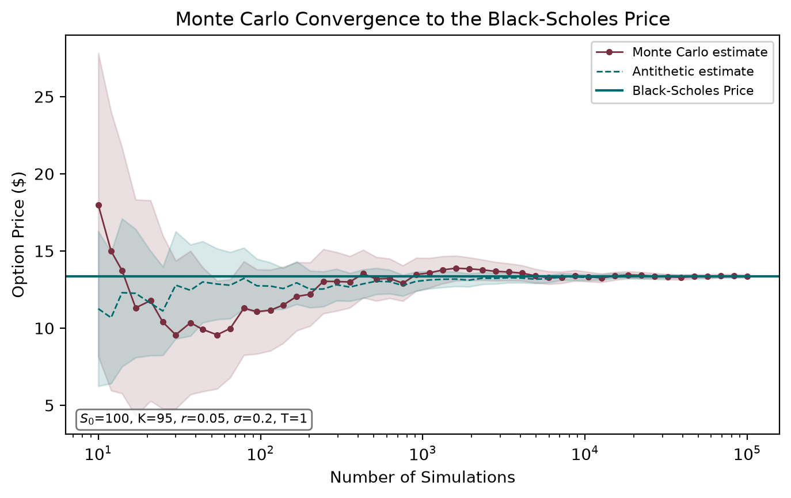
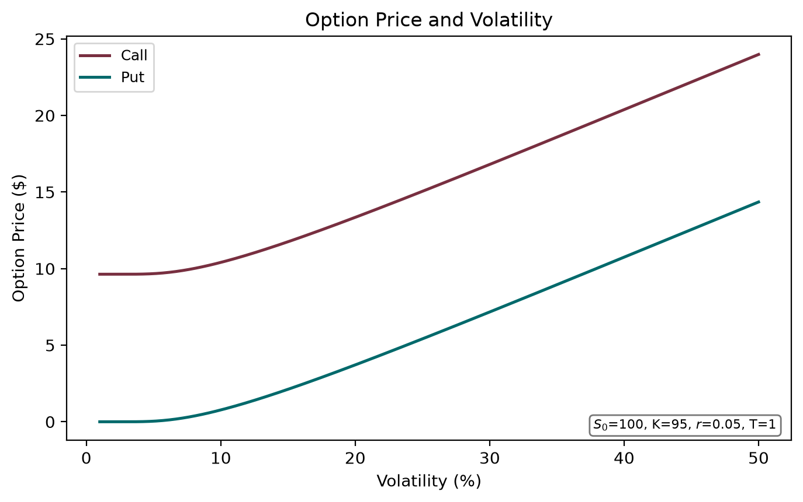
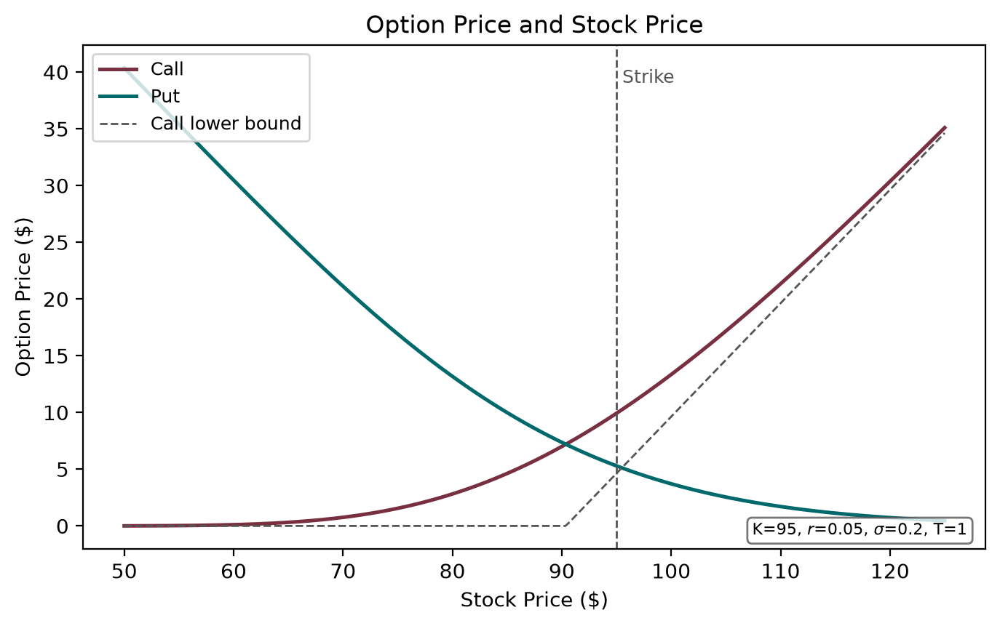

# Option Pricing with Monte Carlo

[Poster PDF](poster/poster.pdf)

I developed this project as part of the Directed Reading Program in Mathematics at Florida State University, Spring 2025.

## Abstract

The Black-Scholes Model was the first widely used method to calculate the theoretical value of an option contract. It uses an assumption of randomness, as in Brownian Motion, to derive the price of a European-style call option. I studied the model under the guidance of a graduate student, using probability theory, stochastic calculus, and differential equations.

I then used Python to compare exact (Black-Scholes) and simulated (Monte-Carlo) option prices, and plotted graphs to visualize the convergence of Monte-Carlo prices to the exact price and how option prices respond to different variables.

## Summary of Code

`src/`

- `black_scholes.py` - closed-form call, put, and Greeks
- `monte_carlo.py` - simulation with and without antithetic variates
- `make_figures.py` - generates output in `figures/`

`poster/` - contains LaTeX source and PDF/PNG poster

## Model

We assume that the stock price follows the Stochastic DE:

$$dS_t = \mu S_t\,dt + \sigma S_t\,dW_t$$

The Black-Scholes PDE can be solved to give the call price $C$ and put price $P$:

$$C = S_0 N(d_1) - K e^{-rT} N(d_2)$$

$$P = K e^{-rT} N(-d_2) - S_0 N(-d_1)$$

## Results



<<<<<<< HEAD
Monte Carlo call price estimates converge to the Black-Scholes price as the number of simulations grows. The antithetic estimate lands closer to the true price with a tighter confidence band at low simulation counts.
=======
Monte-Carlo estimates converge to the Black-Scholes price with more simulations; antithetic sampling provides a tighter confidence interval.
>>>>>>> 717624e (small edits)



Higher volatility means higher option prices and higher potential for upside



Well below strike price, the call price tends toward zero; above it, it rises with the stock price

## Reproducing the code

Install requirements and run scripts in the following order:

```bash
python3 -m pip install -r requirements.txt
python3 src/black_scholes.py
python3 src/monte_carlo.py
python3 src/make_figures.py
```

I would like to thank Pervez Ali for being a wonderful mentor for this project.
